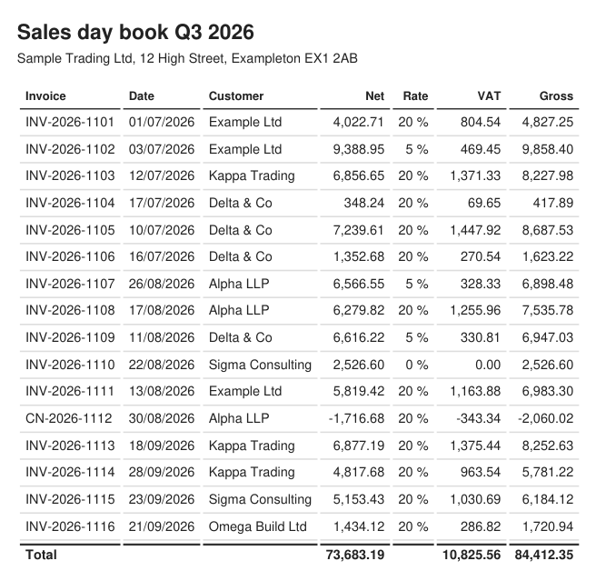
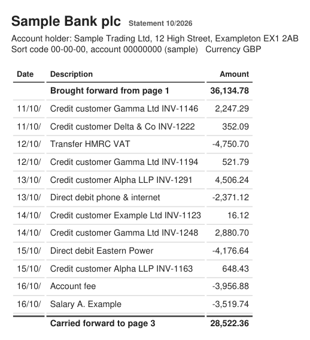
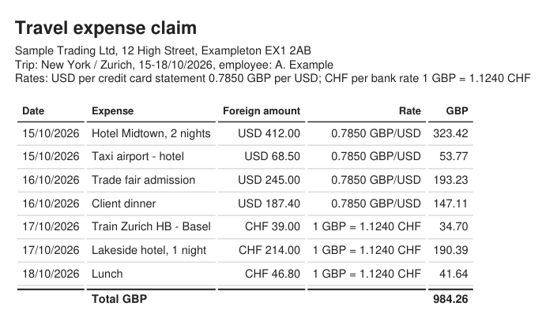
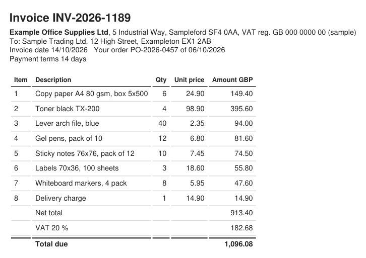

# DeskCalc Verify (MCP server)

Let a human check and confirm numbers in **DeskCalc** before an AI agent relies on the total.

**[deskcalc.com](https://www.deskcalc.com/)** · [DeskCalc Verify](https://www.deskcalc.com/deskcalc-verify.html) · [Download DeskCalc](https://www.deskcalc.com/download-windows-tape-calculator.html?from=verify) ·
[Pricing](https://www.deskcalc.com/pricing.html?from=verify) · [Contact](https://www.deskcalc.com/contact.html)

An agent (Claude Desktop / Claude for Work, Codex, …) extracts amounts from receipts,
statements or invoices and calls `verify_numbers`. The lines open as a labelled tape in
DeskCalc on the user's Windows PC; the user checks every line, corrects what is wrong and
presses **Confirm** in DeskCalc. Only then does the agent get the confirmed total, the lines
and the list of corrections.

## Privacy

- **The check runs on your PC.** The server talks to DeskCalc through files in
  `Documents\DeskCalc Verify`; it opens no network connection, needs no account and sends
  no telemetry. The calculation is done by DeskCalc itself, not by the AI.
- **What the AI sees:** the document you give it (that is between you and your AI provider,
  as without this tool) and the confirmed result: total, lines, your corrections.
- **What stays local:** the tapes in DeskCalc and the audit records (PDF) in
  `Documents\DeskCalc Verify\Prüfnachweise` / `Audit records`. Job files are deleted after each check.
- Without a cloud relay: chat clients that only accept remote (HTTPS) MCP servers
  (ChatGPT chat, Microsoft 365 Copilot, Copilot Studio) are not supported on purpose.

## Requirements

- Windows, DeskCalc **11.3 or later** (website or Microsoft Store version)
- Node.js 20+ (Claude Desktop brings its own)

## What it checks

| Check | How the agent sends it |
|---|---|
| Sum of amounts (receipts, expenses - 30 receipts on one tape) | `{label, value}` per line |
| Quantity × unit price against the printed line total | `{label, qty, price, value}` |
| VAT added or included, computed by DeskCalc from the subtotal | `{type:"tax", rate, included?, value?}` |
| Discount / surcharge / Skonto in percent | `{type:"percent", rate, value?}` |
| Mixed VAT rates: one block per rate, GT line | `{type:"group", label}` before each block |
| Printed subtotals / carry-overs (statements, ledgers) - names the first wrong one | `{type:"subtotal", label, value}` |
| Footing and cross-footing a table: each row is a block on the tape (net, tax, printed gross as checkpoint), so DeskCalc shows net + tax; column totals against the printed ones. Up to 125 rows per tape | `{label, value: gross, net, tax}` + `expected_net_total`, `expected_tax_total`, `row_labels` |
| Foreign currency (amount × rate) | `{label, foreign, currency, fx_rate, value}` |
| Amount payable | `expected_total` |

Cent rounding as documents do it (per line, per tax amount, or tax per position as many
billing programs do) is reported as a rounding difference, not as an error.

## Tools

| Tool | Purpose |
|---|---|
| `verify_numbers` | open the tape, wait for Confirm → `confirmed` (total, lines, corrections, document check) or `pending` |
| `get_verification` | continue waiting for a `pending` review |
| `compare_verifications` | reconcile two confirmed tapes (invoice ↔ delivery note, order, payment) |
| `save_audit_record` | PDF audit record for the working papers (document, date, user, lines, corrections, check, fingerprint) |
| `deskcalc_status` | is DeskCalc installed, is a review open |

Ready-made **prompts** (Claude Desktop: "+" menu → deskcalc-verify): check an invoice, add up
expense receipts, foot and cross-foot a table, check a statement with carry-overs, reconcile
two documents.

Values are plain numbers with `.` as decimal separator; negative for credits.

## Try it with the sample documents

[`samples/en`](samples/en) (and [`samples/de`](samples/de) in German) holds fictitious documents with
**deliberate errors**. Attach one in Claude Desktop, pick the prompt, check the tape in DeskCalc and
press Confirm. Each folder has a `Solution.txt` with the expected findings - don't attach it.

| Sample | Prompt | What Verify should find |
|---|---|---|
| [V4 Expenses](samples/en/V4%20Expenses): 30 receipts + an expense claim | Add up expense receipts | One tape, 30 lines, total 1,316.75. Receipt 18 prints VAT 8.72 instead of 8.32. The claim is added up 1.00 too high and has receipt 12 as 50.74 instead of 57.04 (reconcile claim and receipts) |
| [V5 Bank statement](samples/en/V5%20Bank%20statement): 3 pages with carry-overs | Check a statement with carry-overs | Carried forward page 2 is 10.00 off (first error); the closing balance only follows from it |
| [V6 Cross-footing](samples/en/V6%20Cross-footing): sales day book, 16 rows | Foot and cross-foot a table | INV-2026-1107: 6,566.55 + 328.33 = 6,894.88, printed 6,898.48; net column 100.00 too high |
| [V7 Reconcile](samples/en/V7%20Reconcile): purchase order + invoice | Reconcile two documents | Toner invoiced at 98.90 instead of 89.90, archive box not invoiced, delivery charge not ordered; net difference -13.10 |
| [V8 Foreign currency](samples/en/V8%20Foreign%20currency): travel expenses in USD and CHF | "check the conversions and the total" | Trade fair admission 245.00 USD x 0.7850 = 192.33, printed 193.23; the total follows from it |

Then say "save the audit record": the PDF for the working papers lands in
`Documents\DeskCalc Verify\Audit records` (in German `Prüfnachweise`, following DeskCalc's language).

<table>
<tr>
<td width="50%"></td>
<td width="50%"></td>
</tr>
<tr>
<td></td>
<td></td>
</tr>
</table>

How the cross-footed table looks on the DeskCalc tape - every row is a block, DeskCalc adds net +
VAT itself and puts it next to the gross printed on the document:

```
INV-2026-1107 Alpha 5%
  Net                       6,566.55  +
  Tax                         328.33  +
  Gross per document        6,894.88  #     <- the document prints 6,898.48
```

And what the AI reports back (abridged):

```
document_check: 3 of 19 figures do NOT match the confirmed tape
  row "INV-2026-1107": net 6566.55 + tax 328.33  document 6898.48, DeskCalc 6894.88 (difference -3.60)
  net column                                     document 73683.19, sum of rows 73583.19 (difference -100.00)
  total                                          follows from the row above, not a new error
```

## Configuration

Claude Desktop: download [`deskcalc-verify.mcpb`](https://www.deskcalc.com/downloads/deskcalc-verify.mcpb)
and double-click it - Claude Desktop installs the extension (it brings its own Node.js).
Or by hand in `claude_desktop_config.json`:

```json
{ "mcpServers": { "deskcalc-verify": { "command": "npx", "args": ["-y", "@deskcalc/verify"] } } }
```

Codex - CLI, IDE extension and the Codex mode of the ChatGPT desktop app share
`~/.codex/config.toml`:

```toml
[mcp_servers.deskcalc-verify]
command = "npx"
args = ["-y", "@deskcalc/verify"]
```

Environment (optional): `DESKCALC_PATH` (path to deskcalc.exe), `DESKCALC_VERIFY_DIR`
(exchange folder, default `Documents\DeskCalc Verify`).

After updating DeskCalc, close it completely once: a DeskCalc that still runs from before the
update does not know the newer line kinds (the server says so).

## Development

```
npm install
npm run build     # dist/server.js
npm test          # unit + end-to-end tests with a fake DeskCalc
python fuzz/fuzz_verify.py --cases 200 --seed 6   # random invoices against the real DeskCalc (probe mode)
node test/live-client.mjs 40   # against a real DeskCalc (set DESKCALC_PATH; run from PowerShell)
npm run mcpb                   # dist/deskcalc-verify.mcpb (Claude Desktop extension)
python samples/make_samples.py # sample documents (PDF, German + English) with deliberate errors
python samples/make_previews.py # README images of the English samples
```

`samples/de`, `samples/en`: fictitious receipts, a bank statement with carry-overs, a sales day
book, an order + invoice and a travel expense claim in foreign currency, each with deliberate
errors and the expected findings (`Lösung.txt` / `Solution.txt`) - for testing and demo videos.

Protocol and plan: website repo `plans/09.4-w17-verify-bauplan.md`, `plans/09.5-w17-verify-pruefer.md`.
